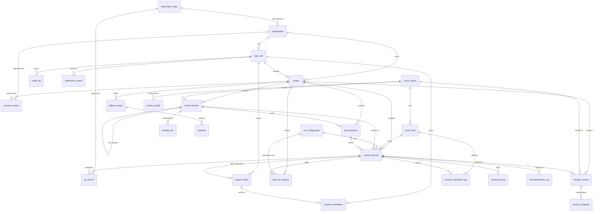

# CloudSphere — Phase 1 Schema Design (draft for review)

Status: **DRAFT — nothing here has been run against a database yet.** Defaults marked **[D#]** are open decisions listed in section 11; they are my recommendations until you confirm or override them.

## 1. Conventions

- Naming: `snake_case`, singular table names. `User` becomes `app_user` (`user` is a reserved word in PostgreSQL).
- Primary keys: `<table>_id BIGINT GENERATED ALWAYS AS IDENTITY` unless stated.
- Timestamps: `TIMESTAMPTZ`, always stored/compared in UTC. Every table has `created_at NOT NULL DEFAULT now()`; mutable tables also have `updated_at` (maintained by a `set_updated_at()` trigger).
- State columns: `TEXT` + `CHECK (... IN (...))` rather than `ENUM` types (cheaper to change in migrations).
- Money: `NUMERIC(12,2)` for invoice/payment amounts, `NUMERIC(12,4)` for unit prices. Percentages: `NUMERIC(5,2)` with `CHECK (x BETWEEN 0 AND 100)`.
- Foreign keys default to `ON DELETE RESTRICT`. Resources are retired through state (`TERMINATED`, `DELETED`), not physically deleted.
- PostgreSQL does not index FK columns automatically; FK columns used in joins get indexes (section 7).
- RAM is stored in whole GB (`ram_gb INTEGER`).

## 2. ER diagram (relationships only; columns are in section 3)



## 3. Data dictionary

Notation: `col TYPE — constraints / notes`. `PK`, `FK→table`, `UQ`, `CK` = check. `created_at`/`updated_at` omitted unless special.

### 3.1 subscription_plan
- `plan_id` PK
- `name TEXT` — NOT NULL, UQ
- `monthly_fee NUMERIC(12,2)` — NOT NULL, CK ≥ 0
- `price_per_vcpu_hour`, `price_per_gb_ram_hour NUMERIC(12,4)` — NOT NULL, CK ≥ 0
- `price_per_gb_storage_month NUMERIC(12,4)` — NOT NULL, CK ≥ 0
- `sla_uptime_target_pct NUMERIC(6,3)` — NOT NULL, CK 0 < x ≤ 100
- `default_max_vcpu`, `default_max_ram_gb`, `default_max_vms INTEGER` — NOT NULL, CK > 0 (used to seed `resource_quota`)
- `is_active BOOLEAN` — NOT NULL DEFAULT true

### 3.2 organization
- `organization_id` PK
- `name TEXT` — NOT NULL, UQ
- `subscription_plan_id` — FK→subscription_plan, NOT NULL
- `billing_email TEXT` — NOT NULL
- `status TEXT` — CK IN ('ACTIVE','SUSPENDED'), default 'ACTIVE'

### 3.3 app_user
- `user_id` PK
- `organization_id` — FK→organization, NULL only for platform admins
- `email TEXT` — NOT NULL; UQ on `lower(email)`
- `password_hash TEXT` — NOT NULL (bcrypt/argon2 hash only; never plaintext)
- `full_name TEXT` — NOT NULL
- `role TEXT` — CK IN ('customer','admin')
- CK `(role = 'admin' OR organization_id IS NOT NULL)`
- `is_active BOOLEAN` default true; `last_login_at TIMESTAMPTZ`

### 3.4 project
- `project_id` PK
- `organization_id` — FK→organization, NOT NULL
- `name TEXT` — NOT NULL; UQ(`organization_id`,`name`)
- `description TEXT`
- `status TEXT` — CK IN ('ACTIVE','ARCHIVED')
- `created_by` — FK→app_user

### 3.5 cloud_region
- `region_id` PK
- `code TEXT` — NOT NULL, UQ (e.g. `ap-south-1`)
- `name TEXT` — NOT NULL; `country TEXT`
- `is_active BOOLEAN` default true

### 3.6 cloud_host
- `host_id` PK
- `region_id` — FK→cloud_region, NOT NULL
- `hostname TEXT` — NOT NULL, UQ
- `total_cpu`, `total_ram_gb INTEGER` — NOT NULL, CK > 0
- `allocated_cpu`, `allocated_ram_gb INTEGER` — NOT NULL DEFAULT 0
- **CK `allocated_cpu BETWEEN 0 AND total_cpu`**, **CK `allocated_ram_gb BETWEEN 0 AND total_ram_gb`** (database-enforced oversubscription guard)
- `free_cpu INTEGER GENERATED ALWAYS AS (total_cpu - allocated_cpu) STORED`
- `free_ram_gb INTEGER GENERATED ALWAYS AS (total_ram_gb - allocated_ram_gb) STORED`
- `status TEXT` — CK IN ('ACTIVE','DRAINING','MAINTENANCE','DECOMMISSIONED')
- `low_capacity_threshold_pct NUMERIC(5,2)` — default 10 (alert when free CPU or RAM falls below this %)

### 3.7 vm_configuration  **[D3]**
- `vm_configuration_id` PK
- `name TEXT` — NULL for ad-hoc sizes; catalog rows like `standard-2x4`
- `vcpu`, `ram_gb INTEGER` — NOT NULL, CK > 0
- `os_family TEXT` — CK IN ('LINUX','WINDOWS')
- `os_image TEXT` — NOT NULL (e.g. `ubuntu-24.04`)
- `is_catalog BOOLEAN` — default false
- UQ(`vcpu`,`ram_gb`,`os_image`) — lets the backend get-or-create a row for custom requests

### 3.8 virtual_machine
- `vm_id` PK
- `project_id` — FK→project, NOT NULL
- `vm_configuration_id` — FK→vm_configuration, NOT NULL
- `host_id` — FK→cloud_host; NULL only while `REQUESTED`
- `name TEXT` — NOT NULL; partial UQ(`project_id`,`name`) WHERE `state <> 'TERMINATED'`
- `state TEXT` — CK IN ('REQUESTED','PROVISIONING','RUNNING','STOPPED','TERMINATED','PREEMPTED','FAILED') **[D1]**
- `is_spot BOOLEAN` — NOT NULL default false
- `subnet_id` — FK→virtual_network, NULL; `private_ip INET` — NULL; partial UQ(`subnet_id`,`private_ip`) WHERE `state NOT IN ('TERMINATED','PREEMPTED','FAILED')`
- `load_balancer_id` — FK→load_balancer, NULL (a VM sits behind at most one LB) **[D4]**
- `created_by` — FK→app_user
- `requested_at`, `started_at`, `stopped_at`, `terminated_at TIMESTAMPTZ`
- CK `host_id IS NOT NULL` when state IN ('PROVISIONING','RUNNING','STOPPED')
- CK `(subnet_id IS NULL) = (private_ip IS NULL)`
- State changes validated by trigger `enforce_vm_state_transition()` (section 6)

### 3.9 storage_volume
- `volume_id` PK
- `project_id` — FK→project, NOT NULL; `region_id` — FK→cloud_region, NOT NULL
- `vm_id` — FK→virtual_machine, NULL when unattached
- `name TEXT` — NOT NULL; UQ(`project_id`,`name`) WHERE `state <> 'DELETED'`
- `size_gb INTEGER` — NOT NULL, CK > 0; `used_gb NUMERIC(10,2)` — NOT NULL DEFAULT 0
- CK `used_gb BETWEEN 0 AND size_gb`
- `volume_type TEXT` — CK IN ('SSD','HDD'); `is_root BOOLEAN` default false
- `state TEXT` — CK IN ('AVAILABLE','ATTACHED','DELETED'); CK `(state = 'ATTACHED') = (vm_id IS NOT NULL)`
- partial UQ(`vm_id`) WHERE `is_root` (one root volume per VM)

### 3.10 virtual_network  (a VPC when `parent_network_id IS NULL`, otherwise a subnet) **[D4]**
- `virtual_network_id` PK
- `project_id` — FK→project, NOT NULL; `region_id` — FK→cloud_region, NOT NULL
- `parent_network_id` — FK→virtual_network (self), NULL for VPCs; CK `parent_network_id <> virtual_network_id`
- `name TEXT` — NOT NULL; UQ(`project_id`,`name`)
- `cidr_block CIDR` — NOT NULL
- Optional hardening (later): trigger checking a subnet CIDR is inside its parent; `EXCLUDE USING gist` (needs `btree_gist`) preventing overlapping sibling subnets

### 3.11 firewall_rule
- `firewall_rule_id` PK
- `virtual_network_id` — FK→virtual_network, NOT NULL
- `direction TEXT` — CK IN ('INGRESS','EGRESS'); `action TEXT` — CK IN ('ALLOW','DENY')
- `protocol TEXT` — CK IN ('TCP','UDP','ICMP','ANY')
- `port_from`, `port_to INTEGER` — CK 0..65535 and `port_from <= port_to`; both NULL for ICMP/ANY
- `remote_cidr CIDR` — NOT NULL
- `priority INTEGER` — CK 1..65535; UQ(`virtual_network_id`,`direction`,`priority`)

### 3.12 load_balancer
- `load_balancer_id` PK
- `project_id` — FK→project; `virtual_network_id` — FK→virtual_network; both NOT NULL
- `name TEXT` — NOT NULL; UQ(`project_id`,`name`)
- `algorithm TEXT` — CK IN ('ROUND_ROBIN','LEAST_CONNECTIONS')
- `listener_protocol TEXT` — CK IN ('HTTP','HTTPS','TCP'); `listener_port INTEGER` — CK 1..65535
- `status TEXT` — CK IN ('ACTIVE','DELETED')
- Member VMs: `virtual_machine.load_balancer_id`

### 3.13 monitoring_log  (partitioned — see section 4)
- `vm_id` — FK→virtual_machine, NOT NULL
- `logged_at TIMESTAMPTZ` — NOT NULL (partition key)
- `cpu_pct`, `ram_pct`, `disk_pct NUMERIC(5,2)` — NOT NULL, CK 0..100
- `net_in_kbps`, `net_out_kbps BIGINT` — NOT NULL, CK ≥ 0
- **PK (`vm_id`, `logged_at`)**

### 3.14 resource_allocation_log
- `allocation_log_id BIGINT` PK
- `vm_id` — FK→virtual_machine, NOT NULL; `host_id` — FK→cloud_host, NULL
- `action TEXT` — CK IN ('ALLOCATE','SCALE_UP','SCALE_DOWN','DEALLOCATE','PREEMPT')
- `old_vm_configuration_id`, `new_vm_configuration_id` — FK→vm_configuration, NULL as applicable
- `vcpu_delta`, `ram_gb_delta INTEGER` — NOT NULL (signed)
- `reason TEXT`; `performed_by` — FK→app_user, NULL for system actions

### 3.15 backup_snapshot
- `snapshot_id` PK
- `volume_id` — FK→storage_volume, NOT NULL
- `name TEXT` — NOT NULL
- `status TEXT` — CK IN ('PENDING','COMPLETED','FAILED','EXPIRED','DELETED')
- `size_gb NUMERIC(10,2)` — CK ≥ 0
- `taken_at TIMESTAMPTZ`, `retention_days INTEGER` — CK > 0
- `expires_at TIMESTAMPTZ` — NOT NULL, CK `expires_at > taken_at` (set by the app; a generated column is not possible because `timestamptz + interval` is not immutable)
- `created_by` — FK→app_user

### 3.16 billing_invoice  **[D9]**
- `invoice_id` PK
- `organization_id` — FK→organization, NOT NULL
- `project_id` — FK→project, NULL for subscription invoices
- `invoice_type TEXT` — CK IN ('SUBSCRIPTION','USAGE'); CK `(invoice_type = 'USAGE') = (project_id IS NOT NULL)`
- `period_start`, `period_end DATE` — CK `period_end > period_start`
- `subtotal`, `tax_amount`, `total_amount NUMERIC(12,2)` — CK ≥ 0, CK `total_amount = subtotal + tax_amount`
- `usage_breakdown JSONB` — snapshot of the calculation (no separate line-item table by default)
- `status TEXT` — CK IN ('DRAFT','ISSUED','PAID','OVERDUE','VOID')
- `issued_at TIMESTAMPTZ`, `due_date DATE`
- UQ(`organization_id`,`project_id`,`invoice_type`,`period_start`,`period_end`) — use `NULLS NOT DISTINCT` (PostgreSQL 15+) or a partial unique index per type

### 3.17 payment (simulated)
- `payment_id` PK
- `invoice_id` — FK→billing_invoice, NOT NULL
- `amount NUMERIC(12,2)` — CK > 0
- `method TEXT` — CK IN ('SIMULATED_CARD','SIMULATED_UPI','SIMULATED_BANK')
- `status TEXT` — CK IN ('PENDING','SUCCEEDED','FAILED','REFUNDED')
- `transaction_ref TEXT` — NOT NULL, UQ (generated token; **no card numbers or real payment data are ever stored**)
- `paid_at TIMESTAMPTZ`; `failure_reason TEXT`

### 3.18 support_ticket
- `ticket_id` PK
- `created_by` — FK→app_user, NOT NULL; `assigned_to` — FK→app_user (admin), NULL
- `project_id` — FK→project, NULL; `vm_id` — FK→virtual_machine, NULL
- `subject TEXT`, `description TEXT` — NOT NULL
- `priority TEXT` — CK IN ('LOW','MEDIUM','HIGH','CRITICAL')
- `status TEXT` — CK IN ('OPEN','IN_PROGRESS','RESOLVED','CLOSED')
- `resolved_at TIMESTAMPTZ` — CK NOT NULL when status IN ('RESOLVED','CLOSED')

### 3.19 customer_feedback
- `feedback_id` PK
- `user_id` — FK→app_user, NOT NULL
- `ticket_id` — FK→support_ticket, NULL; `project_id` — FK→project, NULL
- `rating SMALLINT` — NOT NULL, CK 1..5; `comment TEXT`
- partial UQ(`ticket_id`,`user_id`) WHERE `ticket_id IS NOT NULL`

### 3.20 audit_log  (append-only)
- `audit_id BIGINT` PK
- `actor_user_id` — FK→app_user, NULL for system actions
- `action TEXT` — NOT NULL (e.g. `VM_STATE_CHANGED`, `LOGIN_FAILED`)
- `entity_type TEXT`, `entity_id BIGINT` — polymorphic reference, deliberately **no FK**
- `old_values`, `new_values JSONB`; `ip_address INET`
- The application role gets INSERT/SELECT only (no UPDATE/DELETE)

### 3.21 recommendation_log
- `recommendation_id` PK
- `vm_id` — FK→virtual_machine, NOT NULL
- `recommendation_type TEXT` — CK IN ('SCALE_UP','SCALE_DOWN','TERMINATE_IDLE','RIGHTSIZE','COST_SAVING')
- `rule_code TEXT` — NOT NULL (which rule fired)
- `trigger_metrics JSONB` — NOT NULL (frozen evidence: averages, window, thresholds)
- `window_start`, `window_end TIMESTAMPTZ`
- `recommended_vm_configuration_id` — FK→vm_configuration, NULL
- `estimated_monthly_saving NUMERIC(12,2)`
- `status TEXT` — CK IN ('PENDING','ACCEPTED','REJECTED','EXPIRED'); `responded_by` FK→app_user; `responded_at`
- `outcome TEXT` — CK IN ('CORRECT','INCORRECT','INCONCLUSIVE'), NULL until reviewed; `outcome_notes TEXT`; `reviewed_at`

### 3.22 resource_quota  **[D6]**
- `quota_id` PK
- `organization_id` — FK→organization, NOT NULL; `project_id` — FK→project, NULL (NULL = org-level row)
- `max_vcpu`, `max_ram_gb`, `max_vms INTEGER` — NOT NULL, CK ≥ 0; `max_storage_gb INTEGER` — NULL = unlimited **[D5]**
- `used_vcpu`, `used_ram_gb`, `used_vms INTEGER` — NOT NULL DEFAULT 0, CK ≥ 0
- **CK `used_vcpu <= max_vcpu`, `used_ram_gb <= max_ram_gb`, `used_vms <= max_vms`**
- UQ(`project_id`); partial UQ(`organization_id`) WHERE `project_id IS NULL`

### 3.23 spot_bid_request  **[D12]**
- `bid_id` PK
- `project_id` — FK→project; `requested_by` — FK→app_user; `vm_configuration_id` — FK→vm_configuration; all NOT NULL
- `region_id` — FK→cloud_region, NULL = any region
- `max_price_per_hour NUMERIC(12,4)` — NOT NULL, CK > 0
- `status TEXT` — CK IN ('OPEN','FULFILLED','PREEMPTED','CANCELLED','EXPIRED','REJECTED')
- `fulfilled_vm_id` — FK→virtual_machine, NULL, UQ; `fulfilled_price_per_hour NUMERIC(12,4)`
- `expires_at`, `fulfilled_at`, `preempted_at TIMESTAMPTZ`

### 3.24 carbon_profile
- `carbon_profile_id` PK
- `region_id` — FK→cloud_region, NOT NULL
- `version INTEGER` — NOT NULL, CK ≥ 1; UQ(`region_id`,`version`)
- `carbon_intensity_gco2_kwh NUMERIC(8,2)` — NOT NULL, CK ≥ 0
- `effective_from TIMESTAMPTZ` NOT NULL; `effective_to TIMESTAMPTZ` NULL = current
- partial UQ(`region_id`) WHERE `effective_to IS NULL` (exactly one current version per region)
- CK `effective_to IS NULL OR effective_to > effective_from`

### 3.25 sla_record  **[D13]**
- `sla_record_id` PK
- `vm_id` — FK→virtual_machine; `subscription_plan_id` — FK→subscription_plan; both NOT NULL
- `period_start`, `period_end TIMESTAMPTZ` — CK `period_end > period_start`
- `target_uptime_pct NUMERIC(6,3)` — snapshot of the plan target at evaluation time
- `measured_uptime_pct NUMERIC(6,3)`; `expected_samples`, `received_samples INTEGER`; `downtime_minutes NUMERIC(10,2)`
- `is_breach BOOLEAN GENERATED ALWAYS AS (measured_uptime_pct < target_uptime_pct) STORED`
- `computed_at TIMESTAMPTZ`; UQ(`vm_id`,`period_start`,`period_end`)

### 3.26 notification_queue  (OPTIONAL, not in the 25 — **[D7]**)
- `notification_id` PK
- `user_id` — FK→app_user, NOT NULL
- `notification_type TEXT` — NOT NULL (e.g. `VM_STATE_CHANGED`, `HOST_LOW_CAPACITY`)
- `payload JSONB`; `dedupe_key TEXT` — UQ, NULL allowed (stops repeated low-capacity alerts)
- `status TEXT` — CK IN ('PENDING','SENT','FAILED'); `sent_at TIMESTAMPTZ`

## 4. `monitoring_log` partitioning and key design

**Shape**

```sql
CREATE TABLE monitoring_log (
  vm_id        BIGINT       NOT NULL REFERENCES virtual_machine(vm_id),
  logged_at    TIMESTAMPTZ  NOT NULL,
  cpu_pct      NUMERIC(5,2) NOT NULL CHECK (cpu_pct  BETWEEN 0 AND 100),
  ram_pct      NUMERIC(5,2) NOT NULL CHECK (ram_pct  BETWEEN 0 AND 100),
  disk_pct     NUMERIC(5,2) NOT NULL CHECK (disk_pct BETWEEN 0 AND 100),
  net_in_kbps  BIGINT       NOT NULL CHECK (net_in_kbps  >= 0),
  net_out_kbps BIGINT       NOT NULL CHECK (net_out_kbps >= 0),
  PRIMARY KEY (vm_id, logged_at)
) PARTITION BY RANGE (logged_at);

-- Bounds written explicitly in UTC so they do not depend on the session time zone
CREATE TABLE monitoring_log_2026_10 PARTITION OF monitoring_log
  FOR VALUES FROM ('2026-10-01 00:00:00+00') TO ('2026-11-01 00:00:00+00');
```

**Why this key**
- PostgreSQL requires every primary/unique constraint on a partitioned table to include the partition key. `(vm_id, logged_at)` does, so no surrogate `log_id` is needed (a `log_id` PK would have to be `(log_id, logged_at)` and would not help any query).
- The PK index on each partition is the `(vm_id, logged_at)` index the project notes ask for, so no extra index is needed for per-VM history. Time-range queries per VM prune partitions and use that index.
- It makes batch ingestion idempotent: `INSERT ... ON CONFLICT (vm_id, logged_at) DO NOTHING`.
- Outbound FK to `virtual_machine` is supported on partitioned tables. **Nothing may reference `monitoring_log`** (a FK to it would need `logged_at` too). `recommendation_log` and `sla_record` therefore store `(vm_id, window_start, window_end)` plus a metrics snapshot instead of row-level FKs.
- VMs are never physically deleted, so `ON DELETE RESTRICT` is safe and partitions can be dropped independently.

**Partition lifecycle**
- Creation: an idempotent function `ensure_monitoring_partitions(months_ahead INT)` runs `CREATE TABLE IF NOT EXISTS ... PARTITION OF ...` for the current month plus N future months. Call it from a daily scheduled job in the backend (`node-cron` or an npm script) because `pg_cron` is not available by default on local installs. The migration also calls it once.
- No `DEFAULT` partition (rows landing there block creation of the matching real partition). Ingestion instead rejects timestamps outside `[now - retention, now + small skew]` with a 4xx.
- Retention: a function `drop_expired_monitoring_partitions(retention_days)` runs `ALTER TABLE ... DETACH PARTITION ... CONCURRENTLY`, optionally exports the detached table to CSV, then drops it. Retention is **90 days as a working default [D10]** — confirm.
- Optional: a BRIN index on `logged_at` for cross-VM time scans; only add it if `EXPLAIN` shows it helps.

## 5. Invariants and where each is enforced

| Invariant | Enforced by |
|---|---|
| Host `allocated_*` ≤ `total_*` | `CHECK` on `cloud_host` (database) |
| Quota `used_*` ≤ `max_*` | `CHECK` on `resource_quota` (database) |
| No two requests grab the same free capacity | Row locks (`SELECT ... FOR UPDATE`, hosts locked in ascending `host_id`; quota rows locked first, org before project) inside one transaction owned by the allocation service **[D8]** |
| Valid VM state transitions | `enforce_vm_state_transition()` trigger (database) |
| Counters match reality | Reconciliation query (`allocated_cpu = SUM(vcpu)` of capacity-holding VMs per host; same for quota) — run in tests and after seeding |
| A VM only uses subnets/LBs/volumes of its own project | Service-layer check in Phase 3/4, with a DB trigger as optional hardening |
| Audit rows cannot be altered | Grants: application role has no UPDATE/DELETE on `audit_log` |
| Quota/capacity are checked server-side | Never only in the frontend |

`allocated_*` and `used_*` are deliberately stored derived counters (needed to lock and check cheaply). They are the intentional denormalization in the design; the reconciliation query is how we prove they stay correct.

## 6. VM lifecycle **[D1] [D2]**

The project notes list `MONITORING` and `SCALED` as states. I recommend treating them as **activities, not states**: a running VM is always monitored, and scaling is an event written to `resource_allocation_log` that returns the VM to `RUNNING`. This keeps the state machine small and avoids a VM being "RUNNING" and "MONITORING" at once.

| From | To | Trigger |
|---|---|---|
| (new) | REQUESTED | customer request accepted |
| REQUESTED | PROVISIONING | host + quota locked, capacity reserved |
| REQUESTED | TERMINATED | cancelled / rejected |
| PROVISIONING | RUNNING | provisioning simulation completes |
| PROVISIONING | FAILED | simulated failure (capacity/quota released) |
| RUNNING | STOPPED | customer stops VM |
| STOPPED | RUNNING | customer starts VM |
| RUNNING | RUNNING | scale up/down (config change + log row) |
| RUNNING / STOPPED | TERMINATED | customer terminates (capacity/quota released) |
| RUNNING (spot only) | PREEMPTED | capacity reclaimed (capacity/quota released) |

`TERMINATED`, `PREEMPTED`, `FAILED` are terminal. Default: a `STOPPED` VM **keeps** its host and quota reservation (no re-placement on start) and is billed at storage-only rate.

## 7. Index plan (each tied to a query; validate with `EXPLAIN` in Phase 7)

| Query | Index |
|---|---|
| Host selection: `WHERE status='ACTIVE' AND region_id = $1 AND free_cpu >= $2 AND free_ram_gb >= $3 ORDER BY ... FOR UPDATE` | partial btree `cloud_host (region_id, free_cpu, free_ram_gb) WHERE status = 'ACTIVE'` using the generated columns. The notes' suggested index may not match these columns; with a handful of seed hosts the planner will seq-scan, which is expected, so judge it on a larger generated host set |
| VM metric history `WHERE vm_id=$1 AND logged_at BETWEEN ...` | PK `(vm_id, logged_at)` on `monitoring_log` |
| VMs per project by state | `virtual_machine (project_id, state)` |
| VMs per host (reconciliation, drain) | `virtual_machine (host_id)` WHERE `state IN ('PROVISIONING','RUNNING','STOPPED')` |
| Invoice usage aggregation (VM runtime/size changes) | `resource_allocation_log (vm_id, created_at)`; `virtual_machine (project_id)` |
| Quota lookup | `resource_quota` UQ on `project_id` |
| Audit trail by entity / by actor | `audit_log (entity_type, entity_id, created_at DESC)`, `(actor_user_id, created_at DESC)` |
| Pending notifications | partial `notification_queue (created_at) WHERE status = 'PENDING'` |
| Recommendations per VM / pending | `recommendation_log (vm_id, created_at DESC)`; partial on `status='PENDING'` |
| Expiring snapshots | partial `backup_snapshot (expires_at) WHERE status = 'COMPLETED'` |
| Remaining FK joins | plain btree on `payment(invoice_id)`, `storage_volume(vm_id)`, `firewall_rule(virtual_network_id)`, `support_ticket(created_by)`, etc. |

## 8. Normalization notes

Key functional dependencies (all determinants are candidate keys → BCNF unless noted):
- `vm_id → project_id, host_id, vm_configuration_id, state, ...`
- `host_id → region_id, hostname, capacities`; because of this, **region is not stored on `virtual_machine`** (it would be a transitive dependency).
- `vm_configuration_id → vcpu, ram_gb, os_image`; and `(vcpu, ram_gb, os_image)` is also a candidate key.
- `plan_id → prices, SLA target, default quotas`; plan data lives once, referenced by organization.
- `virtual_network_id → project_id, region_id, parent, cidr`; `(region_id, version)`-style keys on `carbon_profile`: `(region_id, version) → intensity, validity`.
- `project_id → organization_id` (so quotas/billing reach the organization through the project where possible).

Deliberate departures (documented so they are not mistaken for mistakes):
1. Stored counters `cloud_host.allocated_*`, `resource_quota.used_*` (derived data kept for locking/performance; reconciled).
2. `billing_invoice.organization_id` duplicates what `project_id` implies, because subscription invoices have no project **[D9]**.
3. JSONB snapshots (`usage_breakdown`, `trigger_metrics`, `audit_log.old/new_values`) are historical evidence that must not change when source data changes.
4. `sla_record.target_uptime_pct` is a snapshot of the plan's target at evaluation time.

## 9. Migration order (plain SQL files in `database/migrations/`, forward-only, each in one transaction)

| # | Contents |
|---|---|
| 0001 | Extensions (`pgcrypto`, optional `btree_gist`), `set_updated_at()` |
| 0002 | `subscription_plan`, `cloud_region` |
| 0003 | `organization`, `app_user`, `project` |
| 0004 | `carbon_profile`, `cloud_host` (+ generated columns, host-selection index) |
| 0005 | `vm_configuration`, `virtual_network`, `load_balancer`, `firewall_rule` |
| 0006 | `virtual_machine` + state-transition trigger |
| 0007 | `storage_volume`, `backup_snapshot` |
| 0008 | `resource_quota`, `resource_allocation_log` |
| 0009 | `monitoring_log` (partitioned) + `ensure_monitoring_partitions()` + retention function |
| 0010 | `billing_invoice`, `payment` |
| 0011 | `spot_bid_request` (after `virtual_machine`, avoiding a circular FK) |
| 0012 | `support_ticket`, `customer_feedback`, `audit_log`, `notification_queue` |
| 0013 | `recommendation_log`, `sla_record` |
| 0014 | Grants for the application role (DML only; `audit_log` append-only) |

No circular foreign keys exist in this order. Migration tracking: a `schema_migrations` table maintained by a small runner script **[D14]**.

## 10. Seed-data plan (deterministic, repeatable, natural-key lookups instead of hard-coded IDs)

- **Plans:** Basic (SLA 99.5), Standard (99.9), Premium (99.99), with different unit prices and default quotas.
- **Regions (3):** `ap-south-1`, `eu-west-1`, `us-east-1`; `carbon_profile` v1 for each, plus a v2 for one region (tests versioning; v1 gets an `effective_to`).
- **Hosts (7):** two normal hosts per region; one **tiny** host (4 vCPU / 8 GB) and one **95%-full** host for insufficient-capacity tests; one `MAINTENANCE` host that must never be selected.
- **Organizations (3) / users:** one platform admin, customers in each org (a third org exists to test cross-tenant isolation). Passwords hashed with `pgcrypto crypt(..., gen_salt('bf'))`; dev-only credentials listed in the README, never reused.
- **Projects (3):** two in org 1, one in org 2.
- **Quotas:** one generous project, one moderate, and a **tiny, nearly-used project quota** (e.g. 3 of 4 vCPU used) so a 2-vCPU request fails on quota while hosts still have room.
- **VM configurations:** 6 catalog sizes (1x2 … 32x64 Linux) + one Windows size.
- **Sample resources:** ~6 VMs across states (RUNNING, STOPPED, TERMINATED, one spot), volumes with attachments, one VPC + subnet + firewall rules + LB, snapshots, one invoice + payment, one ticket + feedback, one recommendation, one SLA record.
- **Monitoring data:** `generate_series`-based, no `random()` (formula-driven so it is identical on every run): ~7 days at 5-minute intervals for 2 VMs — one sustained-high CPU, one idle — to exercise recommendation rules.
- **Consistency rule:** host `allocated_*` and quota `used_*` in the seed must equal what the seeded VMs imply; the reconciliation query must return zero differences after seeding.
- **Reset:** a dev-only script drops/recreates the `public` schema, re-runs migrations and seeds.

## 11. Open decisions (defaults are what this draft assumes)

| ID | Question | Default |
|---|---|---|
| D1 | `MONITORING` / `SCALED` as states or events? | Events (section 6) |
| D2 | Does a STOPPED VM keep its host/quota reservation? | Yes |
| D3 | `vm_configuration`: shared catalog + get-or-create ad-hoc rows, or per-VM rows? | Shared, unique on (vcpu, ram, image) |
| D4 | Extra `subnet` / LB-membership tables? | No: self-referencing `virtual_network`, `virtual_machine.load_balancer_id` |
| D5 | Is storage capacity enforced? | Optional `max_storage_gb` on quota only; no host storage capacity |
| D6 | Quota scope | One row per project, plus optional org-level row; lock org then project |
| D7 | `notification_queue` | Add as documented optional 26th table |
| D8 | Who owns allocation transaction logic? | Express service (Phase 4); Phase 8 `AllocateResource` only if the course requires it, and then it replaces (not duplicates) the Express logic |
| D9 | Invoice breakdown and subscription billing level | JSONB `usage_breakdown`; invoices carry `organization_id` + nullable `project_id` |
| D10 | Monitoring retention / is partitioning a graded deliverable? | 90 days; implement partitions from the start |
| D12 | Spot price rule | Deterministic: on-demand rate × a discount factor driven by region utilization; bid ≥ current spot price to fill |
| D13 | Uptime measure for SLA | Received vs expected monitoring samples while the VM is RUNNING |
| D14 | Migration tooling | Plain numbered SQL + tiny Node runner (no extra dependency) |

## 12. Running checklist

**Done:** proposed structure, ER diagram, data dictionary, partition design, migration order, seed plan, open decisions (this document).
**Pending:** confirm D1–D14, then Phase 2 (migrations + seeds).
**Known issues / risks:** host-selection index value can only be judged on a larger generated dataset; MySQL-vs-PostgreSQL conflict in the source documents is resolved in favour of PostgreSQL.
